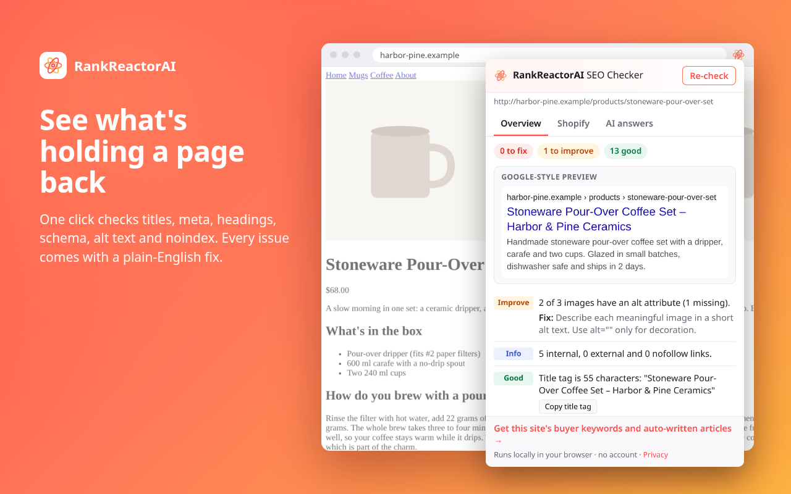

# RankReactorAI: AI SEO Checker for Shopify & small sites

Free one-click SEO check for any page. Shopify-aware tips and an AI-answer readiness score, each with a clear fix.

A Manifest V3 extension for Chrome and Microsoft Edge. Click the toolbar button on any page and it grades that page in plain English. The check runs in your browser, with no account and nothing sent to us.

**Chrome Web Store link coming soon.** Until then, you can [load it unpacked](#build-and-load-it-locally).



## What it checks

**Overview (every page)**

- Title tag and meta description length, with a Google-style search preview
- Indexability: meta robots, googlebot, the `X-Robots-Tag` header (noindex / none) and the HTTP status
- H1 count and H2 structure, plus a heading outline you can copy
- Canonical URL (missing, or pointing somewhere else)
- Image alt text: missing, empty (decorative) or on linked images
- Schema / JSON-LD types, including blocks that fail to parse
- Word count, internal, external and nofollow links
- Open Graph and Twitter card tags, with a share preview
- `lang` attribute, `robots.txt` and sitemap discovery

**Shopify (only when a Shopify store is detected)**

- Product schema with an offer (price, currency, availability) and rating info
- Product image alt text
- Shopify's default "Product – Store name" title pattern
- Products linked through `/collections/…/products/…` and whether they canonicalise to `/products/…`
- Thin collection descriptions, and whether the store links to a blog

Each tip says where to fix it in Shopify admin.

**AI answers**

Eight hygiene checks for AI search: a direct answer near the top, question-style subheadings, FAQ content or schema, Organization / brand identity, author, a published or updated date, lists or tables, and whether `robots.txt` blocks AI crawlers (GPTBot, OAI-SearchBot, ChatGPT-User, ClaudeBot, PerplexityBot, Google-Extended). `llms.txt` is reported but not scored.

This is a hygiene check, not a guarantee. No tool can promise that an AI assistant will cite a page.

The length thresholds match the free tools at [rankreactor.ai/tools](https://rankreactor.ai/tools).

## Privacy and permissions

- **Permissions:** `activeTab` and `scripting`, nothing else. No host permissions, no background service worker, no content scripts that run on page load.
- **When it runs:** only when you click the toolbar button, and only on that tab.
- **Network:** from inside the page, the check makes same-origin requests to the site you are looking at: `/robots.txt`, `/sitemap.xml`, `/llms.txt` and a `HEAD` request to the page itself (for the status code and `X-Robots-Tag`). They are sent without cookies (`credentials: "omit"`). The extension never contacts RankReactorAI or any other third party, and it does not load the page's `og:image`.
- **Data:** page content, URLs and results stay in the popup and are gone when it closes. No account, analytics or tracking.
- **Links:** the buttons that open rankreactor.ai carry only UTM parameters (`utm_source=chrome-extension`…). They never include the page or site you checked.
- **No remote code:** everything ships in the package. `eval` and `new Function` are banned by the lint config.

Privacy policy: <https://rankreactor.ai/privacy-policy>

## Build and load it locally

Requires Node.js 20.19+ (CI uses Node 22).

```sh
npm ci
npm run build   # writes dist/
npm run zip     # writes release/rankreactor-seo-checker-<version>.zip (manifest at the zip root)
```

The manifest version is taken from `package.json` at build time.

**Chrome:** open `chrome://extensions`, turn on Developer mode, click **Load unpacked** and pick `dist/`.

**Edge:** open `edge://extensions`, turn on Developer mode, click **Load unpacked** and pick `dist/`. The same package works in Edge with no changes. It needs Chrome or Edge 120 or newer.

## Development

```sh
npm run lint        # ESLint + Prettier check
npm run typecheck   # tsc --noEmit (strict)
npm test            # Vitest + jsdom unit tests on HTML fixtures
npm run test:e2e    # Playwright: loads the built extension in Chromium
```

The e2e run needs Playwright's Chromium (`npx playwright install chromium`). Automation can't click the toolbar button, so the e2e tests load a test-only copy of `dist/` with host permissions for the local fixture server. The shipped manifest is not changed.

### Layout

- `src/inject/`: the script injected with `chrome.scripting.executeScript`. It is bundled as one IIFE that collects the page facts and returns them as JSON.
- `src/rules/`: pure functions that turn facts into findings (overview, Shopify, AI answers).
- `src/lib/`: JSON-LD and robots.txt parsing, and the CTA link builder (an allowlist of rankreactor.ai URLs).
- `src/popup/`: the Preact popup.
- `tests/`: unit tests and HTML fixtures. The demo stores in the fixtures are fictional.

Stack: TypeScript (strict), Preact, Vite (unminified output, so reviewers can read it), Vitest, ESLint, Prettier.

## Want it done for you?

The extension tells you what to fix. [RankReactorAI](https://rankreactor.ai/) finds the searches your buyers make, then writes and publishes articles to your blog. Comparisons:

- [RankReactorAI vs RankAI for Shopify](https://www.rankreactor.ai/blog/rankreactorai-vs-rankai-shopify-seo-automation-vs-publish-ugc)
- [RankReactorAI vs Surfer SEO](https://www.rankreactor.ai/blog/rankreactorai-vs-surfer-seo-articles-plus-ugc-video)

## Contributing and support

Issues and pull requests are welcome. Please keep the extension local-only: no new permissions, and no network requests beyond the same-origin ones above.

Support: [rankreactor@mail.grokbot.com](mailto:rankreactor@mail.grokbot.com)

## License

[MIT](LICENSE) © RankReactor
